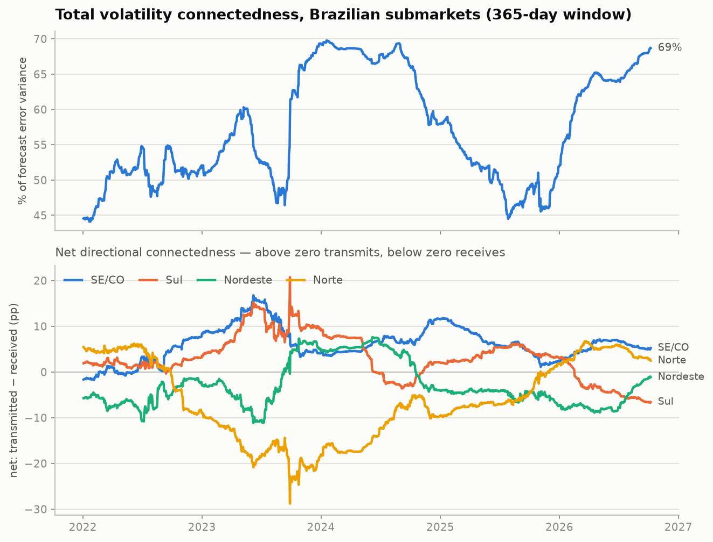
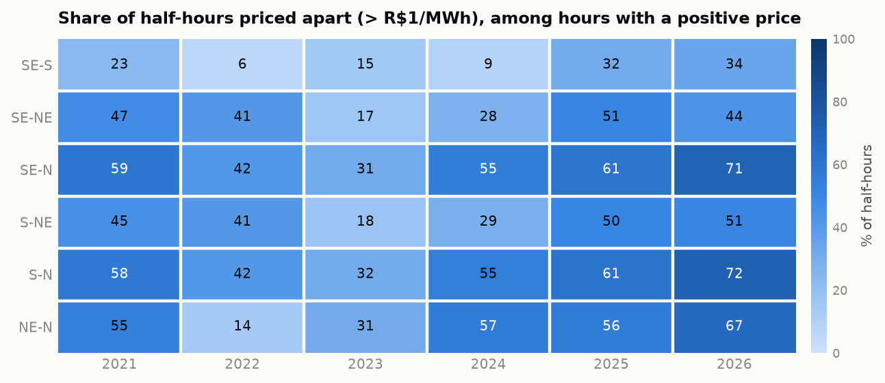

# pororoca

**Volatility connectedness across the four submarkets of the Brazilian power system.**

[](https://www.python.org/)
[](LICENSE)
[](https://pypi.org/project/connectedness/)

> The *pororoca* is the tidal bore that runs hundreds of kilometres up the Amazon
> against the current — a shock born in one system propagating deep into another.
> That is the object this repository measures.

How much of the volatility in one Brazilian submarket is inherited from the other
three? Who transmits, who receives, and when does the national grid stop behaving
like one market and start behaving like four? This repository answers those
questions with the Diebold-Yilmaz connectedness framework applied to realized
(semi)covariances of half-hourly marginal cost, 2021–2026, using the
[`connectedness`](https://pypi.org/project/connectedness/) package.

---

## Headline results

Sample: **2,066 complete days**, 48 half-hours each (99,168 observations), four
submarkets, 2021-01-01 to 2026-10-08.

| | |
|---|---|
| Total connectedness index (realized variance, full sample) | **57.9%** |
| Range over 365-day rolling windows | **44.1% – 69.8%** |
| Most recent window (2026-10-08) | **68.7%** |
| Largest net transmitter (2024–2026 average) | **SE/CO, +6.1 pp** |
| Largest net receiver (2024–2026 average) | **Norte, −5.3 pp** |

**Three findings.**

**1. The grid is not one network — it is two blocks.** The strongest links by far
are SE/CO↔Sul and Nordeste↔Norte; the cross-block links are roughly half as
strong. Average pairwise connectedness, 2024–2026 (share of the receiving
market's forecast error variance attributable to the sending market):

| | SE/CO → | Sul → | Nordeste → | Norte → |
|---|---|---|---|---|
| **→ SE/CO** | — | **29.9** | 17.8 | 15.9 |
| **→ Sul** | **31.1** | — | 15.8 | 14.4 |
| **→ Nordeste** | 19.8 | 16.7 | — | **21.2** |
| **→ Norte** | 18.9 | 16.0 | **21.9** | — |

**2. SE/CO is the system's net transmitter, in every regime.** It is the only
submarket with a positive net position in all three sub-periods, and its lead
widens as the system segments.

**3. The system is segmenting, not integrating.** The share of half-hours in
which a pair of submarkets clears at *different* prices — i.e. a transmission
constraint binds between them — rises sharply from 2024 onwards. SE/CO and Norte
priced apart in 71% of half-hours in 2026, against 31% in 2023.

<picture>
  <source media="(prefers-color-scheme: dark)" srcset="figures/connectedness-dark.png">
  
</picture>

<picture>
  <source media="(prefers-color-scheme: dark)" srcset="figures/separation-dark.png">
  
</picture>

---

## Why CMO and not PLD

This is the main modelling decision in the repository, and it is not cosmetic.

### The Brazilian price is not an auction price

In most liberalised power markets the spot price is the clearing price of an
auction over supply offers. **Brazil does not work that way.** The settlement
price for differences (*Preço de Liquidação das Diferenças*, PLD) is produced by
a chain of centralised stochastic optimisation models run by the system operator:

- **NEWAVE** — medium/long-term policy over hydrological scenarios; produces the
  future cost function (FCF) that prices stored water;
- **DECOMP** — short-term, weekly, inheriting NEWAVE's FCF;
- **DESSEM** — daily, half-hourly unit commitment and dispatch; since January 2021
  it is the model that underpins the hourly PLD.

The price that comes out is the **shadow price of the dispatch problem**: the
marginal operating cost (*Custo Marginal de Operação*, CMO) of meeting one more
unit of load. Nobody bids it.

### PLD is a censored transform of CMO

PLD is CMO after regulatory truncation. For 2026 ANEEL set the floor at
**R$ 57.31/MWh**, the structural cap at **R$ 785.27/MWh** and the hourly cap at
**R$ 1,611.04/MWh**. That truncation is not a rare event. In this sample:

| Share of half-hours with CMO exactly zero | 2021 | 2022 | 2023 | 2024 | 2025 | 2026 |
|---|---|---|---|---|---|---|
| SE/CO | 1.1 | 14.4 | **92.6** | 12.7 | 7.8 | 13.9 |
| Sul | 1.0 | 14.7 | **93.3** | 13.5 | 2.6 | 11.6 |
| Nordeste | 1.6 | 37.6 | **92.4** | 15.5 | 14.1 | 20.7 |
| Norte | 0.7 | 17.4 | **80.5** | 10.0 | 3.7 | 2.8 |

Between a fifth and a third of all half-hours price at zero cost — surplus hours
driven by hydrology and by the solar and wind build-out. Every one of them is a
half-hour that PLD reports at the floor.

**Why that breaks a realized-volatility study.** Realized variance is the
within-day sum of squared intraday price changes. Where PLD sits pinned at its
floor, consecutive differences are mechanically zero. The estimator does not see
"a calm hour"; it sees *no variation at all*, across stretches of hours in which
the underlying system cost was in fact moving. The consequences compound:
realized variance is biased down precisely in the surplus regime, the
distribution of the realized measures acquires a point mass that the probability
integral transform cannot repair, and the covariance terms pick up spurious
co-movement, because four submarkets pinned at the same floor look perfectly
synchronised.

**So the panel is built on CMO.** It is the same quantity, from the same model,
before the regulatory clamp — the uncensored signal the estimator needs. Three
further advantages: it is published **semi-hourly** (48 observations per day
against 24 for hourly PLD, which materially improves realized covariance
estimates), it covers 2021 onwards without a methodology break, and it is
genuinely open.

> **A practical note on access.** The CCEE open-data portal (`PLD_HORARIO`) serves
> its download endpoint only to a restricted set of IPs: requests from outside
> Brazil return `403 Acesso bloqueado`. The ONS open-data S3 bucket used here has
> no such restriction. For anyone running this analysis from abroad, that alone
> settles the data-source question.

The honest counterpart: **CMO is not the settlement price.** Contracts settle at
PLD. For any commercial reading of these results, estimate on CMO and then map
the regime onto PLD, stating the caps explicitly. Volatility that the caps
truncate is real volatility of system cost, but it is not realised cash flow.

---

## What "connectedness" means when the price comes out of a model

Worth stating plainly, because the usual interpretation does not transfer.

In a bid-based market, a spillover index is read as information transmission:
traders in one zone react to shocks in another. **In Brazil there are no bidders
to react.** The four submarket prices co-move because:

1. they are outputs of **one optimisation** carrying **one future cost function**,
   calibrated on a **common set of hydrological scenarios** — a shared factor by
   construction, not a transmission channel; and
2. they are tied together by the **physical interchange limits** between
   subsystems: whenever a link is unconstrained the two submarkets clear at the
   *same* price, and they separate exactly when it binds.

Point 2 is what makes the exercise worth doing. The generalized FEVD measures how
much the submarkets share; the informative event is **when they stop sharing**.
Falling connectedness in this system is not decoupling noise — it is congestion
and regional scarcity becoming the binding feature of the dispatch. That is why
the price-separation statistic is reported next to the connectedness index: they
are two views of the same mechanism.

The natural next step, and the way to turn this from a description into an
indicator, is to regress the net directional and pairwise series on observable
mechanisms. The covariates sit in the same ONS API and the download helper
already reaches them: `intercambio-nacional` (hourly flows between subsystems,
scheduled and verified), `ena-diario-por-subsistema` (natural energy inflow) and
`ear-diario-por-subsistema` (stored energy). Not done here.

---

## Full results

### Static connectedness, realized variance, full sample

Each row is a receiving submarket, each column a sending one. Entries are
percentages of the row market's forecast error variance.

| FROM ↓ / TO → | Norte | Nordeste | Sul | SE/CO | **FROM others** |
|---|---|---|---|---|---|
| **Norte** | 44.41 | 21.44 | 15.90 | 18.24 | 55.59 |
| **Nordeste** | 21.69 | 45.18 | 15.32 | 17.80 | 54.82 |
| **Sul** | 14.59 | 13.43 | 40.32 | 31.66 | 59.68 |
| **SE/CO** | 15.82 | 15.07 | 30.50 | 38.60 | 61.40 |
| **TO others** | 52.11 | 49.95 | 61.73 | **67.69** | |
| **NET** | −3.48 | −4.87 | +2.05 | **+6.30** | |

**Total spillover index: 57.87%.**

### By regime

| Regime | Days | TSI | NET SE/CO | NET Sul | NET Nordeste | NET Norte |
|---|---|---|---|---|---|---|
| 2021 water crisis | 363 | 46.47% | +1.4 | +1.2 | −4.0 | +1.4 |
| 2022–2023 surplus | 700 | 63.05% | +6.8 | +7.2 | +2.3 | **−16.3** |
| 2024–2026 segmentation | 1,003 | 58.73% | **+8.0** | +0.2 | −3.6 | −4.6 |

### Good versus bad volatility

Realized semicovariances split the realized covariance matrix into the part
generated by co-movements of the same sign and the part generated by products of
opposite sign (Bollerslev et al., 2020). Both systems are the vech of the 4×4
matrix — ten series — so their indices are comparable with each other but **not**
with the 57.87% of the four-variable realized-variance system.

| Measure | TSI |
|---|---|
| Positive semicovariance (`recov_pos`) | 73.49% |
| Negative semicovariance (`recov_neg`) | 71.56% |

Upside volatility is marginally more contagious than downside, but the asymmetry
is weak — considerably weaker than what the same decomposition finds in bid-based
electricity markets such as Australia. One more sign that the common driver here
is a dispatch model rather than trader behaviour.

### Price separation

Share of half-hours (%) in which a pair priced more than R$1/MWh apart, computed
**only over half-hours in which at least one of the two prices is positive**.
Without that condition the statistic is swamped by zero-cost hours, where both
prices are trivially equal and the system would look perfectly integrated exactly
when the price signal carries no information.

| Year | SE/CO–Sul | SE/CO–NE | SE/CO–N | Sul–NE | Sul–N | NE–N |
|---|---|---|---|---|---|---|
| 2021 | 23.1 | 47.2 | 59.2 | 45.1 | 57.9 | 54.6 |
| 2022 | 5.9 | 41.3 | 41.7 | 41.2 | 41.6 | 14.0 |
| 2023 | 15.1 | 16.5 | 30.9 | 17.9 | 31.6 | 30.5 |
| 2024 | 8.5 | 27.6 | 55.1 | 28.5 | 54.9 | 56.7 |
| 2025 | 31.6 | 51.4 | 60.9 | 50.3 | 61.1 | 56.0 |
| 2026 | 34.3 | 43.6 | 70.7 | 50.7 | 72.4 | 66.8 |

### Price level and intraday dispersion

| Year | Mean CMO (R$/MWh), SE/CO · Sul · NE · N | Mean within-day sd, SE/CO · Sul · NE · N |
|---|---|---|
| 2021 | 525.2 · 525.9 · 466.5 · 475.9 | 37.2 · 35.1 · 55.1 · 29.9 |
| 2022 | 31.1 · 31.3 · 24.2 · 22.9 | 3.2 · 3.0 · 2.8 · 2.1 |
| 2023 | 6.6 · 6.1 · 6.3 · 6.7 | 8.9 · 8.4 · 8.4 · 8.8 |
| 2024 | 107.6 · 108.3 · 89.7 · 166.9 | 31.9 · 33.9 · 46.7 · 89.9 |
| 2025 | 216.0 · 226.3 · 150.9 · 163.0 | 73.8 · 66.5 · 76.9 · 62.8 |
| 2026 | 195.7 · 225.9 · 169.0 · 179.1 | 118.2 · 90.8 · 106.6 · 106.7 |

Intraday dispersion has more than tripled since 2024. Whatever else the solar
build-out has done to the level of prices, it has made the shape of the day far
more volatile — which is what gives a half-hourly realized-measure approach
something to work with.

---

## Caveats

**2023 is not usable, and the figures show why.** Over 90% of half-hours price at
zero and the annual mean marginal cost is R$6.6/MWh. Realized variances in that
year are numerical noise, and every rolling window overlapping it inherits the
problem — visible as the violent swing in the net directional panel around late
2023. The sub-period table keeps 2023 inside an explicitly labelled surplus
regime rather than dropping it quietly. Conclusions drawn from windows centred on
2023 should be discarded.

**The estimates use the fast cross-validation preset** (`MHARConfig(fast=True)`:
3 folds, 12 candidate penalties, looser solver tolerance) so that the full run
finishes in minutes. Published numbers should be re-estimated with the default
preset, and the rolling design should be checked against window lengths other
than 365 days.

**Connectedness here is not causal.** See the interpretation section above.

**There is no international dimension to add.** Brazil has no market coupling.
ONS records cross-border exchange only with Argentina and Uruguay, at a scale of
roughly ±0.5–1 GW against tens of GW of national load, and the mechanism is a
price *declared weekly* by traders (`ofertapreco-importacao`), not a coupled
clearing. A cross-country study of South American hydro-dependent spot prices
would be a study of a common climate factor, not of transmission, and would have
to say so.

---

## Data

Every series comes from the [ONS open-data portal](https://dados.ons.org.br/),
CKAN API, mirrored on S3 (`sa-east-1`), licensed CC-BY.

| Dataset | Slug | Used for |
|---|---|---|
| CMO Semi-Horário | `cmo-semi-horario` | the price panel (half-hourly, by submarket) |
| Intercâmbios Entre Subsistemas | `intercambio-nacional` | congestion covariate (roadmap) |
| ENA Diário por Subsistema | `ena-diario-por-subsistema` | inflow covariate (roadmap) |
| EAR Diário por Subsistema | `ear-diario-por-subsistema` | storage covariate (roadmap) |

`pororoca.data.resource_urls(slug)` resolves any of them to download URLs, so
extending the panel needs no new plumbing. Raw downloads are cached under
`data/` and are not committed.

---

## Reproducing

```bash
git clone https://github.com/franrolotti/pororoca
cd pororoca
uv venv && uv pip install -e . --prerelease=allow

python scripts/run_analysis.py --years 2021 2026 --window 365 --jobs 8
```

Downloads about 2 MB from ONS and finishes in a few minutes on a laptop. It
writes every table in this README to `results/`, and both figures, in light and
dark variants, to `figures/`.

```
src/pororoca/
  data.py       ONS access, panel construction, complete-day filter
  dynamics.py   rolling-window directional connectedness  (see below)
  analysis.py   static and sub-period tables, separation and censoring diagnostics
  figures.py    the two README figures, light and dark
scripts/
  run_analysis.py   end-to-end
```

### The one piece that is not in the upstream package

`connectedness.rolling_spillover` fits the MHAR-LASSO on each window, builds the
full generalized FEVD — and then returns only the total index, discarding the
directional and pairwise entries it has just computed. The net directional series
in the figure above, and every pairwise path, need exactly those entries.

`pororoca.dynamics.rolling_directional` re-runs the same per-window estimation
through the package's public primitives (`build_lags`, `fit_mhar_fixed_alpha`,
`generalized_vd`, `spillover_metrics`) and keeps all of it: TSI, directional
TO/FROM, net, the pairwise matrix, and the fixed penalty actually used. The
penalty is selected once on the full sample and held fixed across windows, as
upstream does, so window-to-window movement reflects the data rather than
re-tuned regularization.

Proposed upstream as
[franrolotti/connectedness#8](https://github.com/franrolotti/connectedness/issues/8);
this module can be deleted once that lands.

---

## References

- Diebold, F. X. and Yilmaz, K. (2012). Better to give than to receive: Predictive
  directional measurement of volatility spillovers. *International Journal of
  Forecasting* 28(1), 57–66.
- Diebold, F. X. and Yilmaz, K. (2014). On the network topology of variance
  decompositions: Measuring the connectedness of financial firms. *Journal of
  Econometrics* 182(1), 119–134.
- Koop, G., Pesaran, M. H. and Potter, S. M. (1996). Impulse response analysis in
  nonlinear multivariate models. *Journal of Econometrics* 74(1), 119–147.
- Pesaran, M. H. and Shin, Y. (1998). Generalized impulse response analysis in
  linear multivariate models. *Economics Letters* 58, 17–29.
- Corsi, F. (2009). A simple approximate long-memory model of realized volatility.
  *Journal of Financial Econometrics* 7(2), 174–196.
- Bollerslev, T., Li, J., Patton, A. J. and Quaedvlieg, R. (2020). Realized
  semicovariances. *Econometrica* 88(4), 1515–1551.
- Chanatásig-Niza, E., Ciarreta, A. and Zárraga, A. (2022). A volatility spillover
  analysis with realized semi(co)variances in Australian electricity markets.
  *Energy Economics* 111, 106076.
- MME (2019). *Relatório Técnico GT Metodologia CPAMP nº 01/2019: implantação do
  DESSEM nas atividades de programação da operação e formação de preço horário.*

## License

MIT — see [LICENSE](LICENSE).
